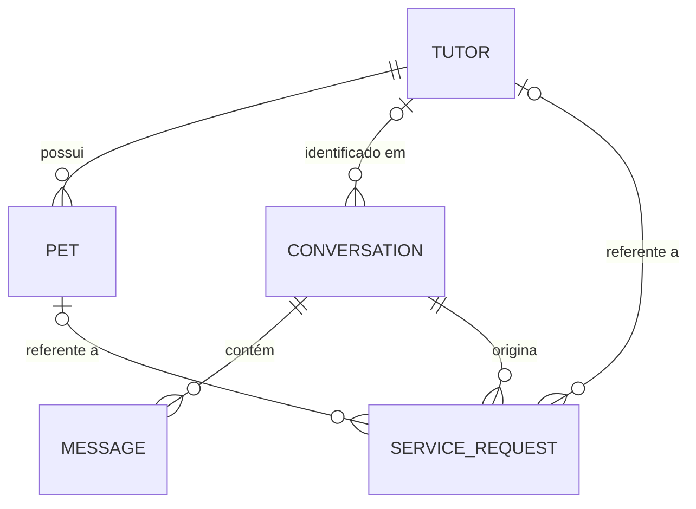

# Modelo de domínio — estado implementado

> Reflete o código ao fim da **Etapa 1** (2026-11-11). Evoluções planejadas: encaminhamento e prioridade (E4), proveniência e detalhes de agendamento (E5).

## Agregados

| Agregado | Estados / regras implementadas | Persistência |
|---|---|---|
| **Conversation** | `OPEN` ⇄ `WAITING_HUMAN` → `CLOSED` (final). Encerramento por equipe (`CLOSED_BY_STAFF`) ou expiração (`EXPIRED`). Expiração = `now > lastActivityAt + prazo(status)`, com prazos sem valor padrão (P-05). Nunca troca de tutor. A atividade nunca volta no tempo. Estado encerrado sempre tem motivo e data | `conversation` |
| **Message** | Imutável. Autor `CUSTOMER` ou `ASSISTANT`; só o assistente registra intenção. Conteúdo obrigatório, até 10.000 caracteres (limite de armazenamento; o limite de entrada é P-09) | `message` |
| **Tutor** | Identificado pelo contato do canal (`ContactIdentity`), único por canal. Nome e telefone opcionais. `lastSeenAt` só avança | `tutor` |
| **Pet** | Vinculado a um tutor. Nome obrigatório. `OTHER` exige descrição da espécie; `DOG`/`CAT` não aceitam descrição. Raça e idade em texto livre | `pet` |
| **ServiceRequest** | `COLLECTING → PENDING → IN_PROGRESS → RESOLVED`; `CANCELLED` a partir de qualquer estado não final. `submit()` recebe o conjunto de campos exigidos (`SUMMARY`, `TUTOR`, `PET`) e recusa listando os ausentes; o conjunto real por tipo é P-13. Sem data/hora confirmada (ADR-0011) | `service_request` |

`Intent` tem as 11 intenções do briefing; valor externo desconhecido vira `OTHER`.

## Relacionamentos

## Escolhas feitas na implementação

Decisões de detalhe tomadas na Etapa 1, sem ADR próprio por serem locais e reversíveis:

| # | Escolha | Motivo |
|---|---|---|
| I-01 | **Pet é um agregado próprio** (repositório próprio, referência ao tutor por id), não parte do agregado Tutor | Mapeamento e consultas mais simples; o tutor não precisa carregar todos os pets para ser salvo. Continua no mesmo módulo (DA-04) |
| I-02 | A **versão de concorrência** (`version`) é carregada pelos agregados | O lock otimista (DM-16, DA-21) só funciona se a versão lida no início do turno for comparada no fim |
| I-03 | `Channel`, `ContactIdentity`, `Timestamps` e `Texts` ficam em `shared.domain` | São usados por `conversation` e `tutor` |
| I-04 | Instantes são **truncados para microssegundos** no domínio | O banco guarda `DATETIME(6)`; assim um agregado salvo e relido é idêntico |
| I-05 | O banco tem **`CHECK`** para valores de enum e para a consistência de conversa encerrada | Defesa em profundidade contra escrita fora da aplicação; um enum novo exige migration |
| I-06 | Mensagens com o mesmo instante (mesmo microssegundo) não têm ordem garantida entre si | Improvável na prática; se for um problema, uma coluna de sequência resolve |

## Ainda não modelado (por etapa)

- E2: unicidade da conversa ativa garantida também no banco (hoje é verificada no adaptador, que falha se encontrar duas).
- E4: `clinicalPriority`, `handoffReason`, `handoffAt` (ADR-0007, ADR-0018).
- E5: proveniência de tutor/pet (ADR-0010), detalhes de agendamento (motivo, preferência), regra de várias solicitações (P-06) e vários pets (P-07).
