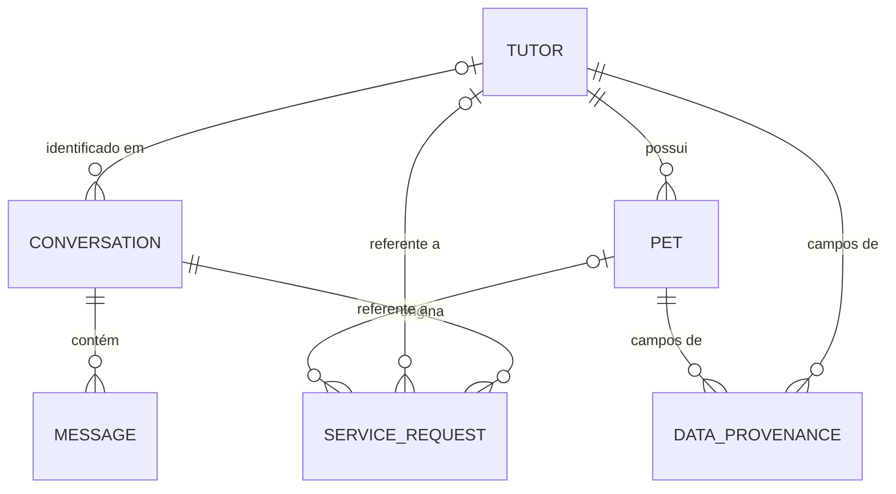

# Modelo de domínio — estado implementado

> Reflete o código ao fim da **Etapa 5** (2026-11-17). A Etapa 2 mudou a persistência (V2); a Etapa 3 acrescentou o módulo `clinicknowledge`; a Etapa 4 acrescentou prioridade clínica, encaminhamento, metadados do turno, registro de mudanças de prioridade e desfecho da solicitação (V3); a Etapa 5 acrescentou proveniência por campo, espécie opcional e detalhes do pedido de agendamento (V4). Regras de coleta: [business-rules.md, seção 10](business-rules.md#10-coleta-de-dados-e-pedido-de-agendamento-etapa-5).

## Agregados

| Agregado | Estados / regras implementadas | Persistência |
|---|---|---|
| **Conversation** | `OPEN` ⇄ `WAITING_HUMAN` → `CLOSED` (final). **E4:** encaminhar exige motivo (`HandoffReason`) e grava o momento; devolver ao assistente limpa os dois. Prioridade clínica (`ClinicalPriority`, P6 ao abrir) independente do status: `raisePriority` só sobe; `changePriorityByStaff` é o único jeito de baixar. Oferta de atendimento humano registrada (uma por conversa). Encerramento por equipe (`CLOSED_BY_STAFF`) ou expiração (`EXPIRED`). Expiração = `now > lastActivityAt + prazo(status)`, com prazos sem valor padrão (P-05). Nunca troca de tutor. A atividade nunca volta no tempo. Estado encerrado sempre tem motivo e data | `conversation` |
| **Message** | Imutável. **E4:** a do assistente carrega `AssistantMetadata` (resposta segura ou não, prioridade efetiva, origem, sinais, intenções secundárias). Autor `CUSTOMER` ou `ASSISTANT`; só o assistente registra intenção. Conteúdo obrigatório, até 10.000 caracteres (limite de armazenamento; o limite de entrada é 2.000 caracteres, DA-28) | `message` |
| **Tutor** | Identificado pelo contato do canal (`ContactIdentity`), único por canal. Nome e telefone opcionais (o assistente não coleta telefone). `lastSeenAt` só avança. **E5:** criado só quando há dado a guardar (DA-36) | `tutor` |
| **PriorityChange** | Registro imutável de mudança de prioridade pela equipe: anterior, novo, nota, autor, momento (H4) | `priority_change` |
| **Pet** | Vinculado a um tutor. Nome obrigatório. **E5:** espécie opcional (o tutor pode dizer o nome antes); quando informada, `OTHER` exige descrição e `DOG`/`CAT` não aceitam descrição. Raça e idade em texto livre. `PetMatcher` faz a correspondência por nome normalizado (`NameKey`) entre os pets de um tutor (DA-35) | `pet` |
| **Provenance** | **E5.** Um registro por campo do cadastro (`DataField`: nome do tutor; nome, espécie, raça e idade do pet). Grava só `MENTIONED` ou `CONFIRMED`, com a conversa e o momento da última confirmação; `statusFor(conversa)` calcula `REGISTERED` ou `TO_RECONFIRM` para as outras conversas. Valor alterado apaga a confirmação (ADR-0010, DA-35) | `data_provenance` |
| **ServiceRequest** | `COLLECTING → PENDING → IN_PROGRESS → RESOLVED`; `CANCELLED` a partir de qualquer estado não final. **E4:** resolver e cancelar exigem desfecho (`RequestOutcome`, DA-34); `OTHER` exige observação. `submit()` recebe o conjunto de campos exigidos (`SUMMARY`, `TUTOR`, `PET`, `REASON`) e recusa listando os ausentes. **E5:** motivo (até 300) e preferência de dia ou período (até 120, texto livre) só no tipo `APPOINTMENT`; o que mais é exigido para registrar o agendamento (confirmação, nome do tutor) fica em `AppointmentRequirements`, na aplicação (P-13 e P-08 provisórios). Sem data/hora confirmada (ADR-0011) | `service_request` |

`Intent` tem as 11 intenções do briefing; valor externo desconhecido vira `OTHER`.

## Relacionamentos

## Escolhas feitas na implementação

Decisões de detalhe tomadas na Etapa 1, sem ADR próprio por serem locais e reversíveis:

| # | Escolha | Motivo |
|---|---|---|
| I-01 | **Pet é um agregado próprio** (repositório próprio, referência ao tutor por id), não parte do agregado Tutor | Mapeamento e consultas mais simples; o tutor não precisa carregar todos os pets para ser salvo. Continua no mesmo módulo (DA-04) |
| I-02 | A **versão de concorrência** (`version`) é carregada pelos agregados | O lock otimista (DM-16, DA-21) só funciona se a versão lida no início do turno for comparada no fim |
| I-03 | `Channel`, `ContactIdentity`, `Timestamps` e `Texts` ficam em `shared.domain` | São usados por `conversation` e `tutor` |
| I-04 | Instantes são **truncados para microssegundos** no domínio | O banco guarda `DATETIME(6)`; assim um agregado salvo e relido é idêntico |
| I-05 | O banco tem **`CHECK`** para valores de enum e para a consistência de conversa encerrada | Defesa em profundidade contra escrita fora da aplicação; um enum novo exige migration |
| I-06 | Mensagens com o mesmo instante (mesmo microssegundo) não têm ordem garantida entre si | Improvável na prática; se for um problema, uma coluna de sequência resolve |

Escolhas da Etapa 2 (aceitas com a etapa em 2026-11-16):

| # | Escolha | Motivo |
|---|---|---|
| I-07 | Unicidade da conversa ativa no banco por **coluna gerada + índice único** (`active_marker`, migration `V2`) | O MySQL não tem índice único parcial. `NULL` não colide, então só a ativa conta (ADR-0009) |
| I-08 | Turno com **lock pessimista** na conversa nas duas transações. Na transação 2, o conflito é detectado pela versão **ou** pela última mensagem gravada | O lock serializa quem altera a conversa. Conferir a última mensagem cobre duas mensagens no mesmo microssegundo, que não mudariam a versão (I-06) |
| I-09 | Mensagem enviada a uma conversa **encerrada ou expirada** vai para a conversa **ativa do contato**, que pode ser aberta nesse momento. A resposta traz `conversationId` e `newConversation` | Mesmo comportamento do WhatsApp, em que o canal só conhece o contato. A URL serve para identificar o contato |
| I-10 | Na falha do turno, a **resposta segura é gravada** como mensagem do assistente, sem intenção. A conversa não é alterada | O histórico mostra o que o tutor de fato recebeu; "estado não muda" vale para status e intenção (ADR-0002) |
| I-11 | O limite de 20 mensagens **conta a atual**; o orçamento de tokens vale para as **anteriores**; estimativa com JTokkit `o200k_base` + 4 por mensagem | ADR-0004 (itens 3, 6 e 7) |
| I-12 | **429 é repetível**, embora o Spring AI o trate como erro não transitório | DA-28 inclui 429 entre os erros com nova tentativa |
| I-13 | Corpo inválido (Bean Validation) → **422**; JSON malformado e parâmetro de consulta inválido → **400** | DM-11 pede 422 para entrada inválida; os outros dois são erros de protocolo |
| I-14 | Sem `ASSISTANT_API_KEY`, ou com menos de 32 caracteres, a aplicação **não sobe** | Evita subir com a API aberta por esquecimento (ADR-0012) |
| I-15 | Em `WAITING_HUMAN`, o turno ainda segue o fluxo normal | O modo restrito é da Etapa 4; até lá, nada coloca conversas nesse status |

Escolhas da Etapa 3 (aceitas com a etapa em 2026-11-16):

| # | Escolha | Motivo |
|---|---|---|
| I-16 | **Uma `ServiceRequest(INFORMATION)` pendente por conversa**; uma nova lacuna acrescenta a pergunta ao resumo (separadas por barra vertical, até 500 caracteres) | Evita um pedido por mensagem; a equipe vê todas as dúvidas da conversa juntas. Exigência de `submit()` para esse tipo: só `SUMMARY` (P-13 ainda pendente) |
| I-17 | O pedido de informação só é criado em turno **válido**. Turno com falha não cria nada | "Estado não muda" na falha (ADR-0002); a resposta segura não afirma lacuna |
| I-18 | A base institucional é um objeto de domínio imutável (`ClinicKnowledge`), carregado uma vez | Mudança na base exige reinício (ADR-0003); o prompt da camada 2 é montado uma vez |
| I-19 | Preço com `payment.prices-disclosed` diferente de `true` é tratado como DESCONHECIDO na carga | Uma regra só, no domínio, vale para o prompt e para o validador (P-11, DA-29) |

Escolhas da Etapa 4 (aguardam o aceite da etapa):

| # | Escolha | Motivo |
|---|---|---|
| I-20 | `PriorityPolicy` e `HandoffPolicy` são classes de domínio sem estado; os detectores (que leem arquivos) ficam na aplicação | Regras testáveis sem Spring; configuração fora do domínio |
| I-21 | O encaminhamento por prioridade usa o **nível do turno**, não o acumulado | Conversa devolvida pela equipe sem rebaixar não volta à fila sozinha |
| I-22 | Uma `ServiceRequest(HUMAN_CONTACT)` aberta por conversa; um novo encaminhamento não duplica | A conversa já está na fila |
| I-23 | Em falha do modelo, prioridade e encaminhamento ainda mudam pelos detectores; intenção e coleta não | Falha da IA não pode atrasar emergência nem pedido de humano (H8, ADR-0007) |
| I-24 | Sinais e intenções secundárias gravados como listas de códigos em colunas de texto | Só para auditoria e métricas; sem consulta por sinal no MVP |

Escolhas da Etapa 5 (aguardam o aceite da etapa):

| # | Escolha | Motivo |
|---|---|---|
| I-25 | `data_provenance` com `subject` + `subject_id` sem chave estrangeira para `tutor`/`pet` (só para `conversation`) | Um registro serve aos dois tipos; os sujeitos nunca são apagados no MVP (retenção é P-03) |
| I-26 | CADASTRADA e A_RECONFIRMAR são calculados, não gravados | O status depende de quem lê (a conversa) e do tempo; gravar exigiria rotina de atualização |
| I-27 | Espécie do pet passou a opcional (V4) | O tutor diz "é para a Mel" antes da espécie; o pedido só é registrado com espécie |
| I-28 | Nome só é aceito se aparece numa mensagem do tutor desta conversa (ou já está no cadastro dele) | Barra nome inventado pelo modelo ou copiado da resposta do assistente |
| I-29 | A confirmação exige que a mensagem anterior do assistente contenha o valor gravado | A marcação do modelo sozinha não basta (P-08 provisório); verificável no backend |
| I-30 | O aviso de pedido registrado é texto do sistema, não do modelo | O modelo não sabe se o registro deu certo; o texto nunca confirma dia nem horário |
| I-31 | Referência a solicitações anteriores (DA-37) consultada pelo contato (`channel` + `external_contact_id`), não pelo tutor | Pedidos de informação e de atendimento podem existir antes do cadastro; contato e tutor são 1:1 |

## Ainda não modelado (por etapa)

- Valores definitivos de P-06, P-07, P-08 e P-13 (hoje provisórios, só com dados fictícios).
