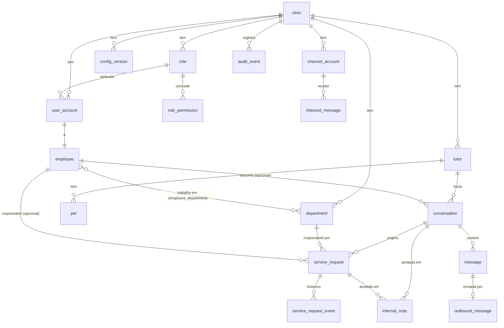
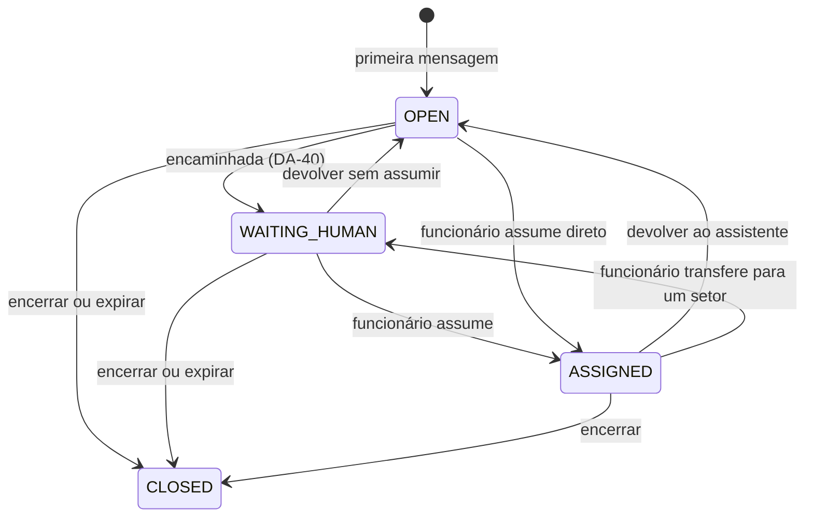

# Modelo de dados do SaaS

> Versão 1 — 2026-11-18. Complementa o [modelo de domínio](domain-model.md) atual (tutor, pet, conversa, mensagem, solicitação, proveniência), que continua valendo.
> Decisões: DA-42 (sem Unidade e sem Tarefa no MVP), DA-43 (`clinic_id` em tudo), DA-49 (usuário e perfil). Arquitetura: [módulos e contratos](saas-modulos-e-arquitetura.md).

## 1. O que entra, o que fica de fora

O briefing (seção 10.6) pede: *"Não criar entidades apenas porque aparecem na lista."*

| Entidade do briefing | No MVP | Motivo |
|---|---|---|
| Clinic / Tenant | `clinic` | Indispensável |
| Unit | **Não** | Uma unidade por clínica. Quando houver mais, uma migração acrescenta `unit_id` (DA-42) |
| Department | `department` | Setor de solicitações, conversas e funcionários |
| Employee / User | `user_account` (identidade, `platform`) + `employee` (equipe, `team`) | Separa identidade de cargo, setor e disponibilidade (briefing 7) |
| Role / Permission | `role` + `role_permission` | Perfis editáveis com permissões de um catálogo fixo |
| Customer / Tutor | `tutor` (existe) | Ganha `clinic_id` |
| Pet | `pet` (existe) | Ganha `clinic_id` |
| Conversation | `conversation` (existe) | Ganha responsável, setor e o estado `ASSIGNED` |
| Message | `message` (existe) | Ganha o autor `STAFF` |
| Service | No documento da configuração | É informação da clínica versionada, não registro operacional |
| KnowledgeEntry | No documento da configuração | Idem. Hoje está no YAML |
| ServiceRequest | `service_request` (existe) | Ganha setor e responsável |
| Task / Assignment | **Não**: o responsável é campo da solicitação; o histórico fica em `service_request_event` | Um dono por vez no MVP (DA-42) |
| Channel | `channel_account` | Liga o número de WhatsApp à clínica |
| AuditEvent | `audit_event` | Indispensável (LGPD e briefing 7) |

**Novas, que o briefing não lista:**

- `config_version`: rascunho, publicação e histórico;
- `internal_note`: notas internas de conversa ou de solicitação (uma tabela, com exatamente um dos dois ids; V7);
- `service_request_event`: histórico da solicitação;
- `inbound_message` e `outbound_message`: idempotência e *outbox*.

## 2. Diagrama

Todas as tabelas, exceto `clinic` e as tabelas de coleção (seção 7), têm `clinic_id` não nulo. `user_account` tem `clinic_id`, mas é lida sem o filtro automático no login (ADR-0021, implementação).

## 3. Entidades novas

### clinic (`platform`)

| Campo | Obrigatório | Observação |
|---|---|---|
| id | sim | UUID |
| name | sim | Nome de exibição |
| time_zone | sim | `America/Sao_Paulo` por padrão (DM-06) |
| status | sim | ACTIVE, SUSPENDED |
| activation_level | sim | 1, 2 ou 3 (DA-48); começa em 1 |
| created_at | sim | |

### user_account (`platform`)

| Campo | Obrigatório | Observação |
|---|---|---|
| id, clinic_id | sim | |
| email | sim | Único **em toda a plataforma**: o login descobre a clínica pelo e-mail (DA-49) |
| password_hash | não | Nulo enquanto o convite não for aceito |
| role_id | sim | |
| status | sim | INVITED, ACTIVE, DISABLED |
| failed_logins, locked_until | sim / não | Bloqueio temporário |
| created_at, disabled_at | sim / não | |

**Ciclo de vida:** INVITED → ACTIVE → DISABLED. Não há exclusão física: a autoria do histórico aponta para a conta.

### role e role_permission (`platform`)

- `role`: id, clinic_id, name (único na clínica), sector_scope (OWN ou ALL) e template (o modelo de origem, opcional).
- `role_permission`: role_id e permission, este do catálogo fixo `modulo:acao`. A chave é (role_id, permission).

Um perfil em uso não pode ser apagado, só renomeado ou alterado.

### employee e employee_department (`team`)

- `employee`:
  - user_account_id, que é também a chave;
  - clinic_id;
  - display_name (obrigatório);
  - job_title (opcional);
  - professional_registration (opcional);
  - availability: AVAILABLE ou AWAY.
- `employee_department`: (employee_id, department_id).

### department (`clinicknowledge`)

| Campo | Obrigatório | Observação |
|---|---|---|
| id, clinic_id | sim | |
| name | sim | Único na clínica |
| kind | sim | RECEPTION, CLINICAL, PETSHOP, OTHER: ajuda nos padrões e nos textos, sem mudar regra de código |
| active | sim | Setor inativo não recebe novas solicitações |
| is_default | sim | Exatamente um por clínica: a Recepção. Recebe o que não tem regra |

**Setores não são versionados.** Renomear vale na hora. Desativar exige que nenhuma regra publicada aponte para o setor.

### config_version (`clinicknowledge`)

| Campo | Obrigatório | Observação |
|---|---|---|
| id, clinic_id | sim | |
| number | sim | Sequencial por clínica |
| status | sim | DRAFT, PUBLISHED, ARCHIVED |
| content | sim | Documento JSON com a mesma estrutura do schema v2 do YAML (DA-39), mais `services[].department-id` e `routing-rules[]` |
| created_by, created_at | sim | |
| published_by, published_at | não | Preenchidos ao publicar |
| version | sim | Lock otimista: dois administradores editando o mesmo rascunho |

**Restrições:**

- No máximo um DRAFT e exatamente um PUBLISHED por clínica, por coluna gerada com índice único, como `active_marker` hoje.
- O conteúdo é validado pelo `KnowledgeSchema` **ao salvar** e **ao publicar**: o mesmo validador do YAML.

**Por que um documento e não uma linha por item:**

- o modelo de informações já é um documento tipado e validado;
- a publicação troca o documento inteiro de uma vez;
- o histórico vira uma lista de versões;
- o diff entre versões sai do próprio documento.

O custo é que a busca dentro do conteúdo não usa o banco, e o MVP não precisa disso.

### internal_note (implementada na V7)

Campos: id, clinic_id, conversation_id ou request_id, author_employee_id, text (até 2.000 caracteres) e created_at.

Notas não são editáveis, só acrescentadas: é o que garante o histórico.

### service_request_event (`servicerequest`)

| Campo | Observação |
|---|---|
| id, clinic_id, request_id, occurred_at | |
| type | ASSIGNED, UNASSIGNED, TRANSFERRED, STATUS_CHANGED (V7). Criação e coleta de dados ficam na própria solicitação |
| actor_employee_id | Nulo = assistente ou sistema |
| from_value, to_value | Setor, responsável ou estado, conforme o tipo |
| reason | Obrigatório em TRANSFERRED (RN-S06) |

### channel_account (`channel`)

| Campo | Observação |
|---|---|
| id, clinic_id | |
| provider | WHATSAPP_CLOUD |
| phone_number_id | Único **na plataforma**: identifica a clínica no webhook |
| display_phone, waba_id | |
| access_token_encrypted | Cifrado com uma chave que vem de variável de ambiente; nunca em log |
| status | ACTIVE, DISABLED |

### inbound_message e outbound_message (`channel`)

**`inbound_message`:**

- campos: id, clinic_id, wamid, from_number, kind (TEXT, MEDIA, OTHER), received_at, processed_at e message_id (a mensagem gravada no `conversation`);
- **único (clinic_id, wamid)** (RF-S51).

**`outbound_message`:**

- campos: id, clinic_id, conversation_id, message_id, status, attempts, next_attempt_at, wamid (preenchido depois do envio), last_error_code e updated_at;
- status: PENDING, SENT, DELIVERED, READ, FAILED.

O texto não é duplicado aqui: vem de `message`.

### audit_event (`platform`)

| Campo | Observação |
|---|---|
| id, clinic_id, occurred_at | |
| actor_user_id | Nulo = sistema |
| action | Ex.: `config.published`, `request.transferred`, `customer.viewed`, `customer.erased`, `user.disabled`, `auth.login_failed` |
| target_type, target_id | |
| summary | Até 500 caracteres, **sem conteúdo de mensagem** nem dado de saúde (RF-S07) |

A tabela só recebe inserções. A retenção é definida com a clínica (P-03).

## 4. Mudanças nas tabelas existentes

| Tabela | Mudança | Migração |
|---|---|---|
| todas as atuais | `clinic_id` não nulo + FK. As chaves únicas passam a começar por `clinic_id`: `uk_tutor_contact`, `uk_conversation_active_contact`, `uk_data_provenance_field` | V5 cria `clinic`, insere a clínica fictícia e preenche `clinic_id` nas linhas existentes |
| `conversation` | Estado novo `ASSIGNED`; `assignee_employee_id` (obrigatório se ASSIGNED, nulo nos outros estados); `waiting_department_id` (setor para onde foi encaminhada) | Etapa S2 |
| `message` | Autor `STAFF`; `staff_employee_id` (obrigatório se STAFF) | Etapa S2 |
| `service_request` | `department_id` não nulo, preenchido com a Recepção nas linhas antigas; `assignee_employee_id` opcional, obrigatório em `IN_PROGRESS` | Etapa S2 |
| `priority_change` | `changed_by` passa de texto a `employee_id`, mantendo o texto antigo na migração | Etapa S2 |

## 5. Ciclos de vida

### Conversa

| Estado | Quem responde ao tutor | O que o tutor ouve sobre a equipe |
|---|---|---|
| OPEN | Assistente | — |
| WAITING_HUMAN | Assistente, só o que é da clínica (DA-40) | "Encaminhei para a Recepção" e o próximo passo; nunca "avisei" |
| ASSIGNED | Só o funcionário. O assistente para, mas a prioridade continua sendo avaliada (RN-S03) | "Ana, da Recepção, está com o seu pedido" |
| CLOSED | — | — |

**Expiração.** `ASSIGNED` não expira por inatividade; quem assumiu encerra ou devolve.

**Desativação.** Se o responsável for desativado, a conversa volta para WAITING_HUMAN no mesmo setor (RN-S07).

### Solicitação

Os estados atuais continuam: COLLECTING → PENDING → IN_PROGRESS → RESOLVED ou CANCELLED, com resultado obrigatório no fim (DA-34). Acrescenta-se:

- PENDING tem setor e pode ter responsável;
- IN_PROGRESS exige responsável;
- transferir de setor mantém o estado e limpa o responsável;
- toda mudança gera um `service_request_event`.

### Versão da configuração

DRAFT → PUBLISHED → ARCHIVED.

- Publicar arquiva a publicada anterior na mesma transação.
- Restaurar copia uma ARCHIVED para um DRAFT novo.

## 6. Propriedade dos dados

| Dado | Dono | Quem lê | Quem altera |
|---|---|---|---|
| Configuração | `clinicknowledge` | `ai` (publicada), web (permissão `config:*`) | Administrador e gerente, pela web |
| Tutor e pet | `tutor` | `conversation`, web (`customer:view`) | Turno (com proveniência), equipe (`customer:edit`) |
| Conversa e mensagens | `conversation` | Web (`conversation:view`, com escopo de setor) | Turno e caixa de entrada |
| Solicitação | `servicerequest` | Web (`request:view`, com escopo de setor) | `conversation` (abrir e coleta); equipe (atribuir, transferir, encerrar) |
| Funcionário | `team` | `conversation` e `servicerequest` (nome e disponibilidade) | Administrador (`team:manage`); a própria pessoa (disponibilidade) |
| Auditoria | `platform` | Web (`audit:view`) | Só inserção, por todos os módulos via `AuditLog` |

## 7. Regras multi-tenant no schema

- Toda tabela exceto `clinic` tem `clinic_id NOT NULL` com FK. Exceção: as tabelas de coleção (`role_permission`, `employee_department`) herdam a clínica pela FK do dono, com exclusão em cascata (V6).
- Todo índice usado em listagem começa por `clinic_id`.
- Toda chave única de negócio inclui `clinic_id`, com duas exceções globais de propósito: `user_account.email` e `channel_account.phone_number_id`. As duas resolvem a clínica antes de existir sessão.
- Nenhuma consulta nativa sem `clinic_id` (teste automático).
