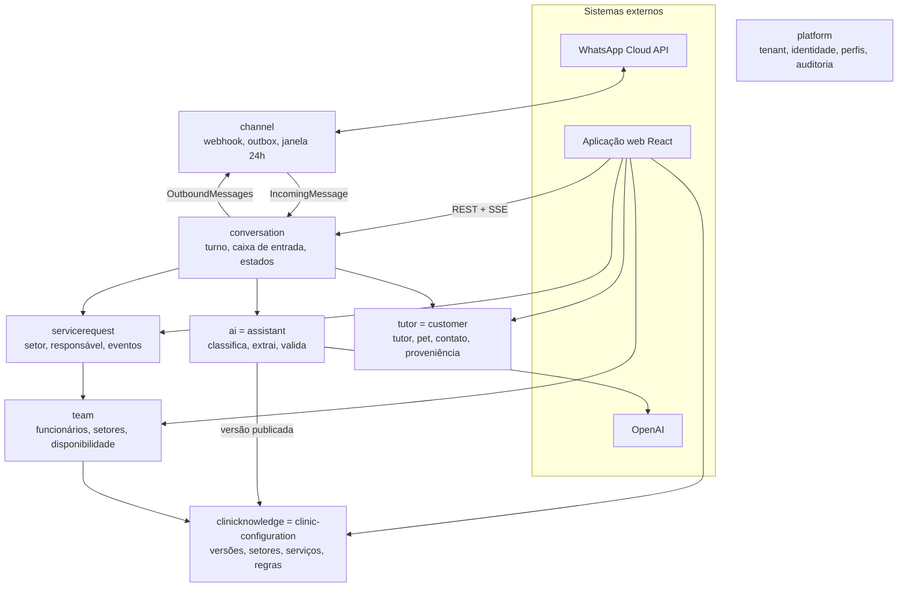

# Arquitetura do SaaS: módulos, fronteiras e contratos

> Versão 1 — 2026-11-18. Decisões: DA-42 (forma do produto), DA-43 (multi-tenant), DA-44 (aplicação web), DA-46 (WhatsApp), DA-49 (perfis). ADRs 0020 a 0025.
> Estende a [visão de arquitetura](architecture-overview.md) atual, que continua valendo para o turno do assistente (ADR-0001, ADR-0017).

## 1. Princípios

- **Monólito modular:** um processo, um banco e um schema. Sem microsserviços.
- **Organização:** cada módulo segue o que já existe hoje: `domain` sem Spring, JPA ou Spring AI; `application` com casos de uso explícitos; `infrastructure` com JPA, web e clientes externos (DM-01).
- **Acesso entre módulos:** um módulo só usa outro pela **API pública** dele (pacote `api` ou interfaces da `application` marcadas como públicas). Nunca pelo repositório nem pela entidade do outro módulo.
- **O modelo de IA não grava nada** (DA-02). Ele devolve o turno estruturado, e o caso de uso decide e grava.
- **Integrações externas ficam atrás de portas**, com testes de contrato: WhatsApp, OpenAI e, no futuro, sistemas de gestão, agenda e e-mail.
- **Nomes de pacote:** os pacotes atuais **não são renomeados** (`ai`, `tutor`, `clinicknowledge`, `servicerequest`). Renomear só traria churn. Os nomes lógicos abaixo aparecem entre parênteses quando diferem do pacote.

## 2. Mapa de módulos

`platform` é usada por todos os módulos (clínica da requisição, usuário atual, auditoria) e não depende de nenhum outro.

## 3. Responsabilidades, dados e contratos

| Módulo | Responsabilidade | Dono das tabelas | API pública (contratos) | Pode depender de |
|---|---|---|---|---|
| `platform` | Clínica (tenant), contas de usuário, perfis e permissões, sessão, auditoria | `clinic`, `user_account`, `role`, `role_permission`, `audit_event` | `TenantContext` (clínica da requisição), `CurrentUser`, `Permissions.check(...)`, `AuditLog.record(...)` | — |
| `clinicknowledge` (clinic-configuration) | Informações da clínica com validade; setores; serviços; regras de encaminhamento; rascunho, publicação e histórico | `config_version` (documento com informações, serviços e regras), `department` | `PublishedConfiguration.current()` → `ClinicKnowledge` (o objeto de hoje), `Departments`, `RoutingRules.departmentFor(type, service)`; casos de uso de edição e publicação | `platform` |
| `team` | Funcionários (cargo, registro, setores), disponibilidade | `employee`, `employee_department` | `StaffDirectory`: quem está disponível no setor X; nome de exibição de um funcionário | `platform`, `clinicknowledge` (setores) |
| `tutor` (customer) | Tutor (com o contato do canal), pets, proveniência, pedidos do titular | `tutor`, `pet`, `data_provenance` | `CustomerRecords` (já existe); busca; exportação e anonimização | `platform` |
| `conversation` | Turno (orquestração, ADR-0017), mensagens, estados, prioridade, assumir, devolver, transferir, responder, notas da conversa | `conversation`, `message`, `priority_change`, `conversation_note` | Casos de uso do turno e da caixa de entrada; consulta de conversas; porta `OutboundMessages` (implementada pelo `channel`) | `ai`, `tutor`, `servicerequest`, `clinicknowledge`, `team`, `platform` |
| `ai` (assistant) | Montagem do prompt, chamada ao modelo, esquema de saída, validação da resposta | nenhuma | `AssistantExecutor` (já existe) | `clinicknowledge` (leitura), `platform` |
| `servicerequest` | Solicitações: setor, responsável, estado, resultado, eventos e notas | `service_request`, `service_request_event`, `service_request_note` | Abrir, atualizar coleta, atribuir, transferir, mudar estado, encerrar; consultas por setor | `team`, `clinicknowledge` (setores), `platform` |
| `channel` | Webhook da Meta, idempotência de entrada, *outbox* de saída, status de entrega, janela de 24 horas, conta do canal por clínica | `channel_account`, `inbound_message`, `outbound_message` | Implementa `OutboundMessages`; entrega `IncomingMessage` ao `conversation` | `conversation` (entrada), `platform` |

**Regras de fronteira que respondem ao briefing (seções 6.5 e 12.3):**

- O atendimento (`conversation`) **não** controla registros clínicos. Ele só abre e atualiza solicitações pelos casos de uso do `servicerequest`.
- O pet shop **não é módulo**. É um setor (DA-42). O que ele pode ver é definido pela permissão (RF-S44), não pelo código.
- O `team` não conhece conversas. O `conversation` pergunta ao `team` quem é o funcionário; o `team` nunca pergunta nada ao `conversation`.
- O `ai` lê **só a versão publicada** da configuração (RN-S08).

**Verificação.** Um teste de arquitetura falha se um pacote acessar `domain` ou `infrastructure` de outro módulo, ou se surgir dependência fora da tabela. A ferramenta (Spring Modulith ou ArchUnit) está em aberto na PT-16, escolhida pela compatibilidade com o Boot 4.0.5.

## 4. Multi-tenant (DA-43, ADR-0021)

| Pergunta do briefing (12.2) | Resposta |
|---|---|
| Como identificar o tenant | **Web:** a clínica do usuário logado (um usuário pertence a uma clínica, DA-49). **Webhook:** o `phone_number_id` de destino, mapeado em `channel_account`. **Tarefas agendadas:** a clínica é passada explicitamente. Nunca por parâmetro ou cabeçalho que o cliente da API possa trocar |
| Como isolar os dados | Coluna `clinic_id` (não nula, com chave estrangeira para `clinic`) em toda tabela de dados da clínica. Hibernate `@TenantId` com um `CurrentTenantIdentifierResolver` lendo o `TenantContext` |
| Como impedir acesso cruzado | Filtro automático do Hibernate nas consultas JPA. Consultas nativas recebem `clinic_id` explicitamente, e um teste lista todas as `@Query(nativeQuery = true)` e falha se alguma não usar `clinic_id`. Chaves únicas e índices começam por `clinic_id`. Acesso a um id de outra clínica devolve 404 |
| Como aplicar permissões dentro da clínica | Permissão por ação no controller ou no caso de uso (`modulo:acao`); escopo de setor checado no caso de uso (ADR-0024) |
| Como testar o isolamento | Todo teste de API cria duas clínicas fictícias e confere que a segunda não vê nada da primeira. Teste de arquitetura: toda entidade de dados da clínica tem `@TenantId` |

**Tabelas sem `clinic_id`:** `clinic` e as tabelas de suporte da própria plataforma, como o histórico do Flyway.

**Unidades:** ficam fora do MVP (DA-42). Quando entrarem, `department` e as demais tabelas que variam por unidade ganham `unit_id` em uma migração.

## 5. Identidade e permissões (DA-49, ADR-0024)

**Conceitos do briefing (seção 7), separados assim:**

| Conceito | Onde fica |
|---|---|
| Identidade | `user_account`: e-mail, hash de senha, estado |
| Cargo | `employee.job_title`, texto livre |
| Qualificação | `employee.professional_registration`, opcional (ex.: CRMV) |
| Setor e função | `employee_department`: os setores em que a pessoa trabalha |
| Permissão | `role` com o conjunto de permissões, mais o escopo de setor |
| Disponibilidade | `employee.availability`: DISPONÍVEL ou AUSENTE |

**Catálogo de permissões.** É fixo no código, com o formato `modulo:acao`. Exemplos:

- `conversation:view`, `conversation:assume`, `conversation:reply`, `conversation:transfer`;
- `request:view`, `request:assign`, `request:close`;
- `customer:view`, `customer:edit`, `customer:export`, `customer:erase`;
- `config:edit`, `config:publish`;
- `team:manage`, `audit:view`.

**Perfis.** Os seis perfis iniciais são linhas criadas na clínica nova e podem ser editados.

**Sessão.** Spring Security com sessão HTTP no servidor, cookie `HttpOnly` + `Secure` + `SameSite=Lax`, CSRF por token e senha com Argon2 ou bcrypt. Há bloqueio temporário após 5 tentativas erradas; o número é provisório.

**Chave de API.** A `X-API-Key` atual fica restrita a testes automatizados e integrações de serviço. Ela não dá acesso às rotas da equipe (ADR-0012 revisto).

## 6. Aplicação web (DA-44, ADR-0022)

- **Estrutura:** React com TypeScript (Vite) em `assistant-backend/web/`. O build é copiado para `static/` e servido pelo Spring. Mesmo domínio: sem CORS, e o cookie de sessão funciona direto.
- **API:** a API REST atual é estendida por módulo, com `ProblemDetail` nos erros (DM-11).
- **Tempo real:** Server-Sent Events (`SseEmitter`). Um canal por usuário recebe "conversa X mudou" e "solicitação Y mudou", só com ids. A tela busca os dados pela API, que aplica a permissão.
- **Testes:** componentes com Vitest; um caminho de ponta a ponta (login, assumir, responder) com Playwright contra o backend com Testcontainers.

## 7. Integrações (ADR-0023)

| Integração | Porta | Adaptador | Falhas |
|---|---|---|---|
| WhatsApp, entrada | webhook `POST /webhooks/whatsapp` | `channel` | Assinatura `X-Hub-Signature-256` inválida → 401, sem gravar. O webhook responde 200 depois de gravar em `inbound_message` (deduplicado pelo `wamid`); o turno roda em seguida, fora da requisição da Meta |
| WhatsApp, saída | `OutboundMessages` (do `conversation`) | `channel`, com *outbox* | Gravada na mesma transação do turno; enviada por um despachante com nova tentativa e espera crescente; depois de N falhas, marcada FALHOU e mostrada na conversa |
| WhatsApp, status | webhook | `channel` | Atualiza `outbound_message.status`; status desconhecido é ignorado e registrado |
| OpenAI | `AssistantExecutor` | `ai` (existe) | Timeout e uma nova tentativa (DA-28); falha → resposta segura com próximo passo (DA-41) |
| Sistemas de gestão, agenda, e-mail | — | — | Fora do MVP. O e-mail de convite e de redefinição de senha usa SMTP, atrás de uma porta `Mailer` |

**Serialização por contato.** Rajadas de mensagens do mesmo contato são processadas uma de cada vez, por fila em memória por conversa. Isso atende o DA-21 sem devolver 409 à Meta. Como só há uma instância no MVP, não é preciso trava distribuída.

## 8. Persistência e consistência

| Tema | Decisão |
|---|---|
| Migrations | Flyway, uma migração por mudança, nunca editada depois de aplicada (DM-04). V5 em diante para o SaaS |
| Identificadores | UUID `BINARY(16)` tipados (DM-14) |
| Integridade | FK de toda tabela de dados da clínica para `clinic`. FKs compostas (`clinic_id`, `id`) entre tabelas de módulos diferentes não são usadas: o filtro do Hibernate e os testes cobrem o caso, sem complicar o schema |
| Concorrência | Lock otimista (`version`) em conversa, solicitação e versão da configuração. Assumir é condicional (só se não houver responsável); quem perde vê "já assumido por …" |
| Idempotência | `inbound_message (clinic_id, wamid)` único; `outbound_message` com id próprio enviado à Meta como referência |
| Transações | Turno em duas transações, com a IA fora de transação (DM-15). A *outbox* é gravada na transação que grava a resposta |
| Auditoria | `audit_event` gravado na mesma transação da ação auditada, pelo `AuditLog` do `platform` |
| Eventos internos | Eventos de aplicação do Spring com `@TransactionalEventListener(AFTER_COMMIT)`, só para efeitos que podem se perder sem dano: aviso SSE para as telas. Nada de negócio depende de evento |
| Configuração publicada | Lida do banco e guardada em cache por clínica, invalidado ao publicar. A validade por seção continua calculada a cada consulta (DA-39) |

## 9. Testes

Os testes existentes (503, com Testcontainers e a bateria de IA real) continuam. Acrescentam-se:

- teste de arquitetura (fronteiras e `@TenantId`);
- isolamento entre clínicas em todo teste de API;
- teste de permissão por perfil (pode e não pode);
- contrato do webhook com cargas reais anonimizadas da documentação da Meta (assinatura, mensagem, status, duplicata);
- teste da *outbox* com falha simulada;
- testes de componente e de ponta a ponta da aplicação web.

A IA continua com modelo falso nos testes comuns e com a task `ai` opcional para o modelo real.
