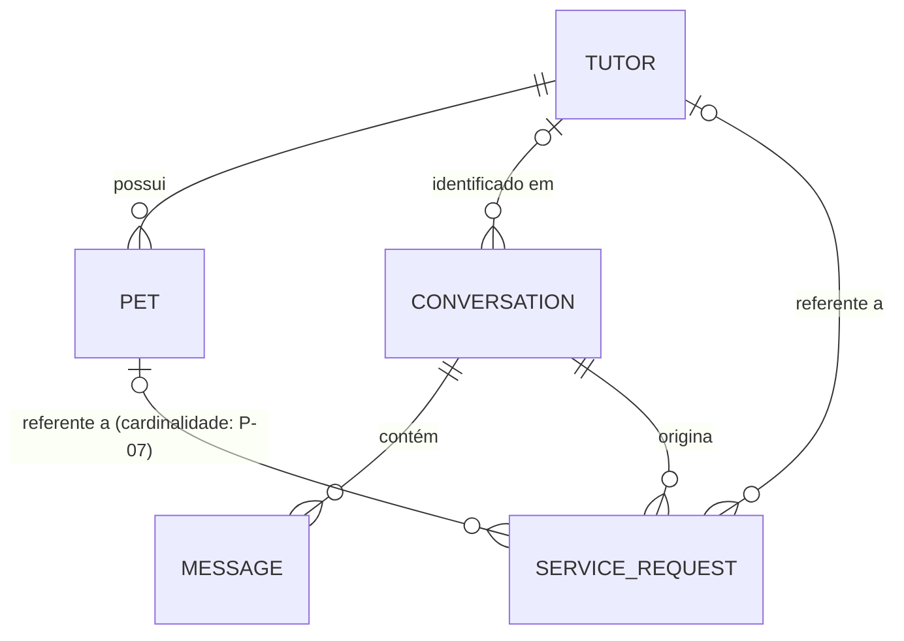
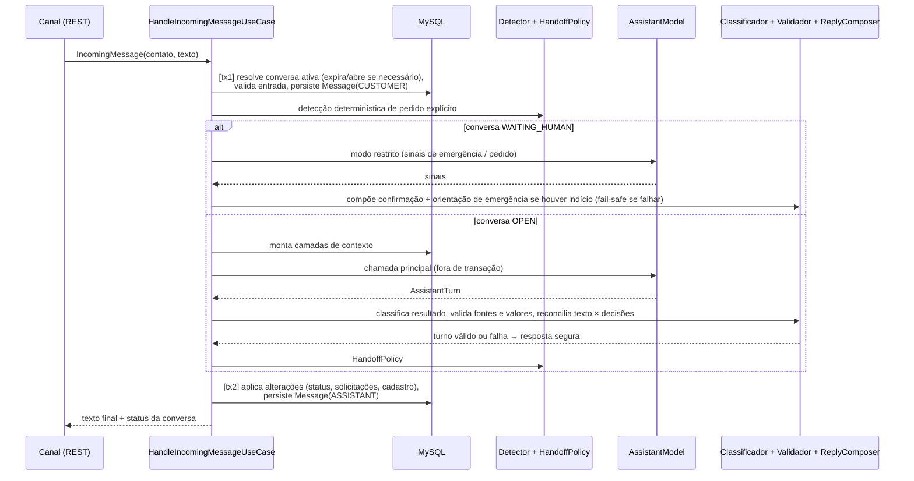

# Proposta técnica do MVP — Assistente Virtual de Atendimento Veterinário

> **Versão 2 — 2026-11-11.** Consolidada após a [revisão técnica](etapa-0-revisao-tecnica.md) e as decisões do responsável pelo projeto.
> **Status:** decisões técnicas aprovadas incorporadas; pendências explicitadas; **implementação não iniciada**.
> Referência analisada: `Desktop/Programacao/Projetos Ativos/budgeting` (commit `545a79d`).

Documentos relacionados:
- [Registro de decisões](registro-de-decisoes.md): decisões aprovadas (`DA`), mantidas (`DM`) e pendências (`P`, `PT`)
- [ADRs](../architecture/adr/README.md)
- [Roadmap](implementation-roadmap.md)
- [Matriz de riscos](matriz-de-riscos.md)
- [Checklist de início da implementação](checklist-inicio-implementacao.md)
- [Diretrizes de Atendimento e Conduta](../product/diretrizes-de-atendimento.md), [Hierarquia de prioridades](../product/hierarquia-de-prioridades.md), [Requisitos derivados](../specs/requisitos-diretrizes.md), [Integração com a arquitetura](../architecture/integracao-diretrizes.md), [Cenários](../specs/cenarios-diretrizes.md), [Aprovações da equipe veterinária](../product/aprovacoes-equipe-veterinaria.md)

Legenda: **[R]** requisito do briefing; **[DA-xx]/[DM-xx]** decisão aprovada/mantida; **[P-xx]/[PT-xx]** pendência (clínica/jurídico ou técnica).

**Mudanças da v1 para a v2:**
- seção 1 preservada;
- seções 2 a 11 atualizadas para:
  - reconciliação e classificação de falhas da IA;
  - validação baseada em fontes;
  - encaminhamento determinístico e tratamento de emergência em `WAITING_HUMAN`;
  - ciclo de vida da conversa;
  - proveniência de tutor/pet;
  - separação entre `ServiceRequest` e conversa;
  - barreira para dados reais;
  - estratégia única de testes de persistência;
- as antigas listas D1–D9 e C1–C12 foram substituídas pelo registro de decisões (mapeamento na seção 5 do registro).

---

## 1. Análise do projeto de referência

### 1.1 O que ele é

Assistente financeiro: recebe áudio, transcreve (Whisper), deixa o `ChatClient` decidir qual *tool* chamar (registrar ou listar transações), sintetiza a resposta em áudio (TTS) e devolve um mp3.

Stack confirmada no `build.gradle`: Java 25 (toolchain), Spring Boot 4.0.5, Spring AI BOM 2.0.0-M4 (`spring-ai-starter-model-openai`), Spring Web, Spring Data JPA, MySQL (`mysql-connector-j`), `spring-boot-docker-compose`, Lombok (plugin freefair 9.2.0), Gradle 9.5.1, JUnit 5. MySQL 9.6 via `compose.yml`. Modelo `gpt-4o-mini`.

### 1.2 O que vale aproveitar (conceitualmente)

| Conceito na referência | Onde | Como reaproveitar |
|---|---|---|
| Porta na aplicação + adaptador de IA na infraestrutura | `DateRangeParser` (application) ← `OpenAiDateRangeParser` (infrastructure/ai) | Mesmo padrão para `AssistantModel` (porta) ← `SpringAiAssistantModel` (adaptador). Permite trocar por *test double*. |
| **IA classifica, aplicação calcula** | O modelo devolve só `DateRangeType`; o cálculo de datas é Java determinístico | Princípio central do novo projeto: o modelo devolve intenção e dados extraídos; o backend valida e decide o que executar. |
| Repositório de domínio + adaptador JPA com mapeamento entidade ↔ domínio | `TransactionRepository` / `JpaTransactionRepository` / `TransactionEntity.toDomain()` | Mantido. Domínio sem anotações JPA. |
| IDs tipados | `TransactionId(UUID)` | Mantido (`ConversationId`, `TutorId`...). |
| Prompt de sistema externo `.st` | `prompts/system-message.st` | Mantido, com mais de um template (ver seção 4). |
| `ToolContext` para dados que vêm da aplicação, não do modelo | `referenceDate` passado pela aplicação | Mantido: `conversationId` e "agora" vêm do backend, nunca do modelo. |
| Testes de IA condicionados à credencial | `@EnabledIfEnvironmentVariable(named = "OPENAI_API_KEY")` | Mantido, com tag JUnit `ai` para executar separadamente. |
| Fuso `America/Sao_Paulo` | `PersistTransactionUseCase` | Mantido, mas via `Clock` injetável. |

### 1.3 O que remover

- `TranscriptionController`, `TextToSpeechController`, propriedades `spring.ai.openai.audio.*`, `OpenAiSpeechModelIT`, `OpenAiTranscriptionModelIT`, `src/test/resources/audio/*`, e o endpoint multipart `/transactions/ai`. **[R]**
- `ChatClientController` e `ChatModelController` (experimentação). **[R]**
- Todo o domínio financeiro (`Transaction`, `Category`, `DateRange*`). Não há nada a portar dele além dos padrões acima.

### 1.4 Problemas da referência que **não** devem ser copiados

1. **`@Tool` dentro dos casos de uso da camada de aplicação**: a aplicação passa a depender do Spring AI e o modelo pode invocar qualquer caso de uso diretamente. No novo projeto, as *tools* (se houver) ficam em `ai/infrastructure/tool`, são adaptadores finos e validam os argumentos antes de chamar o caso de uso.
2. **Orquestração dentro do controller**: `TransactionController` monta o `ChatClient`, transcreve, chama o modelo e sintetiza áudio. No novo projeto o controller só converte DTO ↔ comando.
3. **Regra de negócio na infraestrutura**: o `resolve()` de datas está dentro de `OpenAiDateRangeParser`. Regras ficam no domínio.
4. **Prompt *inline*** no `OpenAiDateRangeParser`: todos os prompts ficam em `.st`.
5. **`spring.jpa.hibernate.ddl-auto=update`** e `show-sql=true`: substituir por Flyway + `validate`. **[R]**
6. **Encoding**: `application.properties` está em ISO-8859-1 e o prompt é lido com `Charset.defaultCharset()`. Os acentos quebram dependendo da máquina. Tudo será UTF-8 explícito.
7. **`Instant.now()` espalhado e `System.out.println`** para debug: usar `Clock` e SLF4J (sem logar conteúdo pessoal).
8. **`logging.level.org.springframework.ai=DEBUG`**: loga prompts inteiros, ou seja, dados pessoais dos tutores. Desligado por padrão. **[R] LGPD**
9. **`BudgetingApplicationTests.contextLoads`** sobe o contexto completo e depende de banco + chave. Testes de domínio não devem depender disso.
10. **`@Data` em entidade JPA** (equals/hashCode sobre campos mutáveis) e um bug latente: `LocalDate.from(Instant)` lança exceção. Decisão: não usar Lombok; usar `record` e classes simples **[DA-08]**.

### 1.5 Compatibilidade de versões

Manter Spring Boot 4.0.5 + Spring AI 2.0.0-M4, que já funcionam juntos na referência. **[R]** Não farei upgrade. Itens a **verificar na Etapa 1** antes de usar (são APIs que mudaram entre milestones):

- Starter do Flyway no Boot 4 (os starters foram modularizados; provavelmente `spring-boot-starter-flyway` + `flyway-mysql`).
- Suporte a *structured output* nativo (JSON Schema estrito da OpenAI) no `ChatClient` do M4 vs. o `BeanOutputConverter` clássico.
- Se existir Spring AI 2.0 GA no momento, avalio a compatibilidade e trago como decisão, sem trocar por conta própria.

---

## 2. Arquitetura

### 2.1 Princípios

- Organização **por módulo de domínio**, com princípios hexagonais: `domain` em Java puro; `application` com casos de uso e as portas estritamente necessárias; `infrastructure` com HTTP, JPA, Spring AI e configuração **[DM-01]** (ADR-0001).
- Dependências apontam para dentro. O domínio não conhece Spring, JPA, Spring AI nem OpenAI **[R]**.
- **Interfaces só onde há substituição real:**
  - `AssistantModel`: OpenAI em produção, *double* nos testes;
  - um repositório por agregado: porta no domínio, adaptador JPA. A motivação é isolar o domínio da JPA; **não haverá repositórios em memória** (ADR-0006).
- **O modelo interpreta; o backend decide e executa.** O modelo não acessa repositórios, entidades ou persistência, e não há tools de escrita **[DA-01, DA-02]** (ADR-0002).
- Sem RAG, banco vetorial, sumarização ou multiagentes **[DM-07]**. Sem Lombok **[DA-08]**.

### 2.2 Módulos e responsabilidades

| Módulo | Responsabilidade | Elementos principais (etapa de introdução) |
|---|---|---|
| `conversation` | Ciclo de vida da conversa, mensagens, orquestração do turno, encaminhamento | `Conversation`, `Message`, `Intent` (E1); `HandleIncomingMessageUseCase`, `ContextAssembler`, porta `AssistantModel`, `AssistantTurn`, `TurnResultClassifier` (E2); `ResponseValidator` (E3); `ExplicitHumanRequestDetector`, `HandoffPolicy`, `ReplyComposer` (E4) |
| `tutor` | Tutor e pets, com proveniência das informações | `Tutor`, `Pet`, `Species` (E1); proveniência e extração (E5) |
| `servicerequest` | Solicitações para a equipe e seu ciclo de vida | `ServiceRequest`, `RequestType`, `RequestStatus` (E1); endpoints da equipe (E4); `AppointmentRequestDetails` (E5) |
| `clinicknowledge` | Informações institucionais tipadas e validadas | `ClinicKnowledge`, `KnowledgeItem`, carregamento e validação do YAML (E3) |
| `ai` | Adaptador Spring AI | `SpringAiAssistantModel`, `PromptTemplates` (E2). `tool/` não existe no MVP |
| `shared` | Configuração transversal | `Clock` (`America/Sao_Paulo`), `GlobalExceptionHandler` com `ProblemDetail` (E1), filtro de API Key (E2) |

```
src/main/java/com/clinicavet/assistant/
├── AssistantApplication.java
├── conversation/{domain, application, infrastructure/{http, persistence}}
├── tutor/{domain, application, infrastructure/persistence}
├── servicerequest/{domain, application, infrastructure/{http, persistence}}
├── clinicknowledge/{domain, application, infrastructure}
├── ai/infrastructure/{chat, prompt}
└── shared/{config, exception, security}
```

Os pacotes só são criados quando recebem código. A forma de o caso de uso do turno interagir com `tutor` e `servicerequest` é **pendente (PT-02)** e precisa ser decidida antes da Etapa 4.

### 2.3 Canal de comunicação

- Sem interface de canal no MVP **[DM-10]**. O caso de uso recebe `IncomingMessage(channel, externalContactId, text, receivedAt)`; `Channel` = `API` no MVP.
- O `externalContactId` é **fornecido pelo canal**, nunca extraído do texto. No canal API, é o chamador que o informa. Por isso a proteção da API Key é parte da segurança do vínculo tutor ↔ contato (ADR-0012).
- Um futuro adaptador WhatsApp entra como novo pacote de infraestrutura. Ele exigirá itens que estão fora do MVP: idempotência por identificador de mensagem, serialização de rajadas e autor `STAFF` (registro de decisões, seção 4).

---

## 3. Modelo de domínio

### 3.1 Entidades

| Conceito | Justificativa no MVP | Campos principais | Etapa |
|---|---|---|---|
| **Conversation** (raiz) | Estado do atendimento, encaminhamento, ciclo de vida | `id`, `channel`, `externalContactId`, `tutorId?`, `status`, `currentIntent?`, `closeReason?`, `startedAt`, `lastActivityAt`, `closedAt?`, `version`; `handoffReason?`, `handoffAt?` | E1 (campos de encaminhamento: E4) |
| **Message** | Persistência e reconstrução do histórico | `id`, `conversationId`, `author` (`CUSTOMER`, `ASSISTANT`), `content`, `createdAt`, `intent?` (mensagens do assistente) | E1 |
| **Tutor** | Identificação do responsável | `id`, `channel` + `externalContactId`, `name?`, `phone?`, `firstSeenAt`, `lastSeenAt` | E1 (proveniência: E5) |
| **Pet** | Animal do tutor | `id`, `tutorId`, `name`, `species` (`DOG`, `CAT`, `OTHER` + descrição), `breed?`, `ageDescription?` | E1 (proveniência: E5) |
| **ServiceRequest** | Pedido que a equipe precisa resolver | `id`, `conversationId`, `tutorId?`, `petId?`, `type`, `status`, `summary`, detalhes por tipo em colunas próprias (DA-19), `createdAt`, `updatedAt` | E1 |
| **ClinicKnowledge** | Informações institucionais | Objeto de valor carregado do YAML; **não** é entidade persistida | E3 |

Escolhas de modelagem:
- `Message` é agregado separado: só a janela recente é carregada.
- O cadastro do tutor guarda só dados persistentes. Motivo, sintomas e preferências pertencem à solicitação ou à conversa (ADR-0010).
- O momento de criação do `Tutor` é **pendente (PT-12)**.

### 3.2 Relacionamentos



Uma conversa pode originar várias solicitações (ex.: `INFORMATION` + `HUMAN_CONTACT`). A regra de quantas podem estar "em andamento" ao mesmo tempo é **pendente (P-06)**.

### 3.3 Conversation: estados e ciclo de vida (ADR-0009)

```
            ┌────────── encaminhamento (ADR-0007) ──────────┐
            ▼                                               │
 (novo) ──► OPEN ◄── return-to-assistant (equipe) ── WAITING_HUMAN
            │                                               │
            └──── close (equipe) / expiração ──► CLOSED ◄───┘
```

- No máximo **uma conversa ativa** (`OPEN` ou `WAITING_HUMAN`) por contato **[DA-13]**.
- A **expiração por inatividade** é avaliada quando o contato volta a escrever: `now > lastActivityAt + prazo(status)` → a conversa vai para `CLOSED`/`EXPIRED` e uma nova é aberta. Os prazos são **pendentes (P-05)**; a configuração é obrigatória e não tem valor padrão.
- `CLOSED` é final.
- Conversa nova recebe só o cadastro de tutor/pet, com proveniência. Não recebe mensagens, solicitações nem estado do atendimento anterior.

### 3.4 ServiceRequest (ADR-0011)

```
COLLECTING ──submit()──► PENDING ──► IN_PROGRESS ──► RESOLVED
    └──────────────────────┴─────────────┴──────────► CANCELLED
```

- Tipos: `APPOINTMENT`, `INFORMATION`, `FOLLOW_UP`, `HUMAN_CONTACT`.
- `submit()` só com dados obrigatórios completos (para `APPOINTMENT`: **P-13**).
- **Solicitação ≠ agendamento [DA-07]:** não existe data/hora confirmada no modelo, só `preferredPeriod` em texto livre. Nome na API: `appointmentRequest`.
- Atualizada pela equipe **separadamente** da conversa. O desfecho (`RESOLVED` com qual resultado?) é **pendente (PT-08)**.

### 3.5 Intenção

Enum com as 11 intenções do briefing **[DM-09]**. O valor inválido é normalizado para `OTHER`. A intenção principal do turno é guardada na mensagem do assistente e atualiza `Conversation.currentIntent`. Mudar de assunto não invalida solicitações em andamento.

- O campo é introduzido na Etapa 2, só como registro, porque faz parte do contrato estruturado e da reconciliação.
- As regras que **dependem** da intenção entram nas Etapas 3 (V4) e 4 (`HandoffPolicy`).
- Uma intenção principal por turno é limitação conhecida; intenções secundárias: **PT-06**.

### 3.6 Proveniência de tutor e pet (ADR-0010)

| Status | Significado |
|---|---|
| MENCIONADA | Dita nesta conversa, extraída pelo modelo, não confirmada |
| CONFIRMADA | Confirmada pelo tutor nesta conversa (critério: **P-08**) |
| CADASTRADA | Do cadastro, confirmada em atendimento anterior, dentro da validade (**P-08**); serve para reconhecer, não como confirmação atual |
| A_RECONFIRMAR | Do cadastro, nunca confirmada ou fora da validade; só pode ser usada como pergunta |

Granularidade (por registro × por campo) e correspondência de pets: **PT-09**.

### 3.7 Encaminhamento (`HandoffPolicy`, ADR-0007)

Encaminha quando **qualquer** condição for verdadeira:
1. pedido explícito detectado deterministicamente (expressões: **PT-10**);
2. intenção `HUMAN_REQUEST` ou `COMPLAINT`;
3. `MEDICAL_CONCERN` ou `TREATMENT_FOLLOW_UP` (encaminhar × oferecer: **P-12**);
4. o modelo sinalizou necessidade de encaminhamento;
5. possível emergência sinalizada;
6. falha do turno envolvendo encaminhamento;
7. situação exclusiva de humano definida pela clínica (**P-12**);
8. prioridade clínica P1–P2 (P3 conforme P-20) (DA-25);
9. insatisfação ou necessidade de decisão de funcionário (DA-25);
10. sofrimento emocional, confusão ou conversa improdutiva: oferta, ou encaminhamento direto conforme P-12 (DA-25).

O backend só adiciona encaminhamentos, nunca os remove. Lacuna de conhecimento gera solicitação `INFORMATION`, sem encaminhar a conversa por si só.

### 3.8 Prioridade clínica (ADR-0018, DA-23)

- `Conversation.clinicalPriority` (P1 possível emergência … P6 relacionamento) é **independente** de `Conversation.status`.
- `PriorityPolicy` (domínio) calcula, a cada mensagem e também em `WAITING_HUMAN`, o nível **mais urgente** entre: sugestão do modelo, pisos do backend e nível atual.
- **Não há rebaixamento automático.** Só um funcionário rebaixa, com registro.
- A prioridade não usa dados comerciais. A fila da equipe é ordenada por prioridade e tempo de espera, com prazo por nível (P-02).
- Critérios clínicos de P1/P2: equipe veterinária (P-20). Lista determinística de expressões de alerta **adotada** (DA-27, ADR-0019): só eleva a prioridade.
- Definição completa: [hierarquia-de-prioridades.md](../product/hierarquia-de-prioridades.md).

---

## 4. Integração com IA e camadas de contexto

### 4.1 Contrato `AssistantTurn` (saída estruturada)

| Campo | Significado | Etapa |
|---|---|---|
| `reply` | Texto proposto ao tutor (pode ser substituído ou complementado pelo backend) | E2 |
| `intent` | Intenção principal | E2 (registro), E3/E4 (regras) |
| `knowledgeRefs[]` | Chaves institucionais usadas na resposta | E3 |
| `knowledgeGap` | Informação não encontrada ou `DESCONHECIDO` | E3 |
| `handoffRequested` + `handoffReason` | O modelo sugere encaminhamento | E4 |
| `possibleEmergency` | Indício de possível emergência (sem classificação de gravidade) | E4 |
| `extracted` | Dados de tutor e pets mencionados | E5 |
| `confirmations[]` | Dados que o tutor confirmou neste turno (critério: P-08) | E5 |
| `appointmentRequest` | Pet, motivo e preferência mencionados | E5 |
| `priority` | Nível sugerido P1–P6 (o backend aplica pisos e nunca rebaixa) | E4 |
| `signals[]` | Sinais da hierarquia (ex.: `EMERGENCY_SIGN`, `WORSENING`, `EMOTIONAL_DISTRESS`, `DISSATISFACTION`, `FINANCIAL_VULNERABILITY`) | E4 |
| `clinicalUncertainty` | Não é possível determinar a gravidade: piso P2 | E4 |

No modo restrito de `WAITING_HUMAN` (E4), a saída tem apenas `possibleEmergency`, `explicitHumanRequest`, `priority` e `signals[]`.

O suporte do Spring AI 2.0.0-M4 a JSON Schema estrito da OpenAI e a forma como a API expõe recusa e `finish_reason` serão verificados na Etapa 2.

### 4.2 Camadas de contexto [DM-08]

| # | Camada | Fonte | Conteúdo | Etapa |
|---|---|---|---|---|
| 1 | Identidade e comportamento | `prompts/system-message.st` | Papel de recepcionista virtual, pt-BR, tom, limites (seção 10), regras de encaminhamento e emergência, regra de que conteúdo delimitado é dado e não instrução. **Sem dados variáveis da clínica.** Persona, idioma e formato: **P-10** | E2 (regras de encaminhamento: E4) |
| 2 | Institucional | YAML tipado (ADR-0003) → `prompts/clinic-context.st` | Itens com chave estável; `null` renderizado como `DESCONHECIDO — confirmar com a equipe`; bloco `<dados_da_clinica>` | E3 |
| 3 | Tutor e pet | Cadastro (ADR-0010) | Só o tutor da conversa; cada informação com seu status de proveniência; bloco `<cliente>` | E5 |
| 4 | Conversa | Tabela `message` | Últimas 20 mensagens **da conversa atual**, limitadas também por orçamento de tokens (ADR-0004); sem sumarização. montado pela aplicação, sem `ChatMemory` (DA-18, ADR-0015) | E2 |
| 5 | Operacional | `Conversation`, `ServiceRequest`, `Clock` | Status, intenção corrente, solicitação em andamento e campos faltantes, encaminhamento, atraso de prazo, data/hora local; bloco `<estado_do_atendimento>` | E2 (data/hora, status), E4 (encaminhamento), E5 (solicitação) |

A mensagem do tutor entra delimitada como dado (`<mensagem_do_cliente>`). O conteúdo institucional e o conteúdo do tutor nunca são tratados como instrução de sistema **[R]**.

### 4.3 Prompts

| Arquivo | Uso | Etapa |
|---|---|---|
| `system-message.st` | Camada 1 | E2 |
| `clinic-context.st` | Camada 2 | E3 |
| `operational-context.st` | Camada 5 | E2 |
| `tutor-context.st` | Camada 3 | E5 |
| `waiting-human.st` | Modo restrito em `WAITING_HUMAN` | E4 |

Todos em UTF-8 explícito **[DM-05]**.

### 4.4 Classificação do resultado e reconciliação (ADR-0002)

1. **Classificação:** cada resposta do modelo é *válida*, *recusa*, *truncada*, *inválida*, *inconsistente* ou *erro técnico*. Só a válida segue; as demais são **falhas**.
2. **Reconciliação** (o backend compõe o texto final, `ReplyComposer`):
   - encaminhamento decidido pelo backend sem que o `reply` o comunique → texto padrão de encaminhamento;
   - `reply` anuncia transferência sem encaminhamento → inconsistente;
   - `reply` afirma notificação → inconsistente;
   - `knowledgeGap` com fatos institucionais no texto → inconsistente;
   - possível emergência → orientação da política aprovada inserida no início do texto.
3. **Falha:**
   - o estado não muda e o tutor recebe a resposta segura padrão;
   - se a falha envolve encaminhamento, a resposta segura é a de encaminhamento;
   - novas tentativas e timeout: no máximo 1 nova tentativa, 30 s (DA-28, ADR-0016).

### 4.5 Proteção contra informação inventada (ADR-0008)

- O modelo declara as fontes (`knowledgeRefs`) e as lacunas (`knowledgeGap`).
- O validador verifica:
  - V1: fontes existentes e conhecidas;
  - V2: valores factuais detectados autorizados pelas fontes citadas ou ecoados do próprio tutor;
  - V3: coerência com a lacuna;
  - V4: resposta institucional sem fonte;
  - V5: ausência de confirmação de agendamento;
  - V6: ausência de afirmação de notificação.
  - V7: ausência de dose de medicamento (DA-29).
- Os formatos detectados estão listados no ADR-0008 (lista final: DA-29).
- **Não há garantia absoluta.** Os limites conhecidos estão documentados no ADR-0008 (valores por extenso, afirmações sem valor detectável, valor correto aplicado ao assunto errado, paráfrases).
- Testes desde a introdução (E3): conjunto versionado de respostas aprovadas e reprovadas e avaliação inicial com IA real e base fictícia.

### 4.6 Tool calling

Não há tools no MVP **[DA-02]**. Reavaliar uma tool **somente leitura** se a base institucional deixar de caber no contexto (ADR-0003).

---

## 5. Fluxo de mensagens

### 5.1 Visão geral



### 5.2 Passos

1. **Conversa e entrada (tx1):**
   - resolve a conversa ativa do contato e aplica a expiração (ADR-0009);
   - valida a entrada (tamanho máximo: 2.000 caracteres, DA-28; conversa não encerrada);
   - persiste a mensagem do tutor **antes** de qualquer chamada ao modelo **[DM-15]**.
2. **Detecção determinística** de pedido explícito de humano (E4). Quando detectado, o encaminhamento está decidido, independentemente do que ocorrer depois.
3. **Conversa em `WAITING_HUMAN`:** fluxo restrito (5.3).
4. **Contexto:** camadas 1–5, conforme a etapa.
5. **Chamada principal** fora de transação, com timeout de 30 s (DA-28).
6. **Classificação, validação e reconciliação** (4.4, 4.5).
7. **Regras (tx2, lock otimista):**
   - `HandoffPolicy`;
   - criação e atualização de solicitações;
   - *upsert* de cadastro com proveniência;
   - persistência da resposta.

   Conflito de concorrência: `409`, com a mensagem do tutor registrada e sem resposta; quem chamou não reenvia (DA-21).
8. **Resposta** ao canal com o texto final e o status da conversa.

### 5.3 Mensagem recebida em `WAITING_HUMAN` (ADR-0007)

- O modelo é chamado em modo restrito, só para sinais (`possibleEmergency`, `explicitHumanRequest`). Não há continuação do atendimento.
- O backend compõe o texto:
  - confirmação de que a mensagem ficou registrada para a equipe, **sem afirmar notificação**;
  - a orientação da política de emergência (**P-01**), quando há indício;
  - a orientação de prazo vencido (**P-02**), quando aplicável.
- Se o modo restrito falhar, a resposta inclui a orientação curta de emergência (fail-safe).

### 5.4 Exemplo: pedido de consulta (com dados fictícios)

| Tutor | Efeito no backend | Resposta |
|---|---|---|
| "Oi, queria marcar uma consulta" | `APPOINTMENT_REQUEST`; `ServiceRequest(APPOINTMENT, COLLECTING)`; faltando pet e motivo (conjunto obrigatório: P-13) | Pergunta para qual pet |
| "Pra Mel, minha cachorrinha" | Pet `Mel/DOG` com status MENCIONADA | Pergunta o motivo |
| "Ela tá vomitando desde ontem" | `MEDICAL_CONCERN`; o comportamento depende de **P-12**. Se a regra for encaminhar: `submit()` → `PENDING`, `ServiceRequest(HUMAN_CONTACT)`, conversa em `WAITING_HUMAN`. Se o modelo sinalizar possível emergência, a orientação da política entra no início do texto | Acolhe; não opina sobre gravidade; diz que o pedido ficou **registrado para a equipe**, que confirmará dia e horário. **Não** diz que está marcado nem que alguém foi avisado |
| "Ok, obrigado" | Modo restrito; sem indício | Confirmação curta de registro |

A equipe vê o pedido em `GET /api/service-requests?status=PENDING` e a conversa em `GET /api/conversations?status=WAITING_HUMAN`.

---

## 6. API HTTP

Todas as rotas `/api/**` exigem `X-Api-Key` desde a Etapa 2 (ADR-0012). Entrada com DTOs próprios e Bean Validation. Erros com `ProblemDetail`: `404` inexistente, `409` conflito de estado ou versão, `422` entrada inválida **[DM-11]**.

| Método | Rota | Função | Etapa |
|---|---|---|---|
| `POST` | `/api/conversations` | Devolve a conversa ativa do contato (`200`) ou cria uma nova (`201`) | E2 |
| `POST` | `/api/conversations/{id}/messages` | Processa a mensagem do tutor; devolve o texto final, o status e a intenção | E2 |
| `GET` | `/api/conversations/{id}/messages` | Histórico paginado | E2 |
| `GET` | `/api/conversations?status=WAITING_HUMAN` | Conversas sinalizadas, **ordenadas por prioridade clínica e tempo de espera**, com atraso por nível | E4 |
| `PATCH` | `/api/conversations/{id}/priority` | Reavaliação da prioridade pela equipe (único caminho de rebaixamento), com registro | E4 |
| `POST` | `/api/conversations/{id}/close` | Encerramento pela equipe | E4 |
| `POST` | `/api/conversations/{id}/return-to-assistant` | `WAITING_HUMAN` → `OPEN` | E4 |
| `GET` | `/api/service-requests?status=PENDING` | Solicitações por status | E4 |
| `PATCH` | `/api/service-requests/{id}` | Transição de status pela equipe; desfecho: PT-08 | E4 |

---

## 7. Persistência

- MySQL via `compose.yml`, com credenciais por variável de ambiente. Flyway e `ddl-auto=validate` **[DM-04]** (ADR-0005).
- UUID em `BINARY(16)`; `DATETIME(6)` em UTC; `America/Sao_Paulo` na apresentação e no contexto **[DM-06]**.
- **Schema por etapa:**
  - `V1` (E1): `conversation`, `message`, `tutor`, `pet`, `service_request` (detalhes em colunas próprias, DA-19);
  - migrations seguintes: colunas de encaminhamento e atraso (E4), proveniência e detalhes de agendamento (E5).
- Índices: `message(conversation_id, created_at)`, `conversation(status)`, `conversation(channel, external_contact_id, status)`, `service_request(status)`, `tutor(channel, external_contact_id)` único.
- A garantia de uma conversa ativa por contato no banco (coluna gerada + índice único, ou lock) é verificada na Etapa 2 (ADR-0009).

---

## 8. Segurança, privacidade e barreira de dados reais

- **Fase de testes (E2–E6):** API Key única, só com **dados fictícios** **[DA-06, DA-17]**. Limitações documentadas no ADR-0012.
- **Entrada em produção / dados reais (E7, obrigatória):**
  - autenticação individual dos funcionários;
  - autorização por perfil (**P-17**);
  - auditoria de acesso a dados pessoais;
  - condições G1–G12 da barreira LGPD (ADR-0014) satisfeitas;
  - recusa de inicialização com *placeholder* ou valor provisório na configuração do ambiente real (ADR-0014);
  - *rate limiting* conforme **PT-07**.
- Contexto sempre restrito ao tutor da conversa. Tutor identificado pelo canal, nunca por telefone digitado.
- Logs sem conteúdo pessoal; Spring AI fora de `DEBUG`; chaves só por variável de ambiente **[DM-12]**.
- Conteúdo do tutor tratado como dado. Sem tools, o impacto de *prompt injection* fica limitado ao texto, e esse texto passa pela validação.
- Não versionar dados reais, questionários preenchidos nem credenciais (ADR-0013).
- **Sem conclusões jurídicas:** finalidade e base legal (P-16), retenção (P-03), transparência e provedores externos (P-04) dependem da clínica, com orientação jurídica.

---

## 9. Testes

| Categoria | Ferramenta | Escopo |
|---|---|---|
| Unitários | JUnit 5 + AssertJ, sem Spring e sem banco | Transições de `Conversation` e `ServiceRequest`, expiração, `HandoffPolicy`, detector, classificador de resultado, validador (conjunto de respostas aprovadas e reprovadas), reconciliação, normalização e proveniência |
| Integração | `@SpringBootTest` + **Testcontainers MySQL** + `AssistantModel` falso | Adaptadores de persistência, migrations, fluxos completos do turno. **Estratégia única** (ADR-0006) |
| IA real | `@Tag("ai")` + `OPENAI_API_KEY`, task separada, **dados fictícios** | Continuidade, respostas institucionais e desconhecidas, perguntas-armadilha, encaminhamento, saúde animal, emergência, *prompt injection* |

- **Docker é pré-requisito** a partir da Etapa 1.
- **Métricas por turno, sem conteúdo** (Etapa 6): intenção, encaminhamento e motivo, reprovação do validador, falha e tipo, tokens, latência. Elas medem os critérios de reavaliação dos ADR-0002, 0004 e 0008.
- Testes com IA real verificam **metadados e regras** (intenção, encaminhamento, lacuna, validação) e rodam cenários repetidos com limite de aprovação. Cada cenário roda 10 vezes, com aprovação ≥ 9/10 (DA-28).

---

## 10. Limites do sistema [DA-15]

Os limites abaixo são complementados pelas [Diretrizes de Atendimento e Conduta](../product/diretrizes-de-atendimento.md) (DA-22). Elas incluem a ausência de pressão comercial, o respeito ao pedido de atendimento humano, a regra de que incerteza não é tratada como segurança e a precedência da segurança do animal sobre a eficiência (DA-24).

**O assistente não:**
- diagnostica;
- prescreve medicamentos ou dosagens;
- orienta suspender ou alterar tratamentos;
- garante que um sintoma não é grave;
- substitui avaliação veterinária;
- inventa preços, horários, serviços ou políticas;
- afirma que um agendamento foi confirmado;
- afirma que alguém foi notificado.

**Encaminha:** questões clínicas, reclamações, incertezas e pedidos de humano, conforme a seção 3.7.

**Limitações conhecidas do MVP** (aceitas e documentadas):
- a validação reduz, mas **não elimina**, informação inventada (ADR-0008);
- uma intenção principal por turno (PT-06);
- informação livre fora da janela de histórico se perde (ADR-0004);
- encaminhamento sem notificação: depende de alguém consultar as listagens (P-14);
- possível solicitação duplicada quando o tutor volta depois da expiração (ADR-0009);
- sem tratamento de rajadas ou duplicatas de canal (necessário só no adaptador WhatsApp).

---

## 11. Decisões e pendências

O estado completo das decisões aprovadas (DA-01 a DA-28), mantidas (DM-01 a DM-16) e pendentes (P-01 a P-08, P-10 a P-20, PT-02, PT-06 a PT-12, PT-14 e PT-15) está no [registro de decisões](registro-de-decisoes.md), com responsável, etapa e o que cada pendência bloqueia. O mapeamento das antigas D1–D9, C1–C16 e I1–I14 está na seção 5 do registro.
