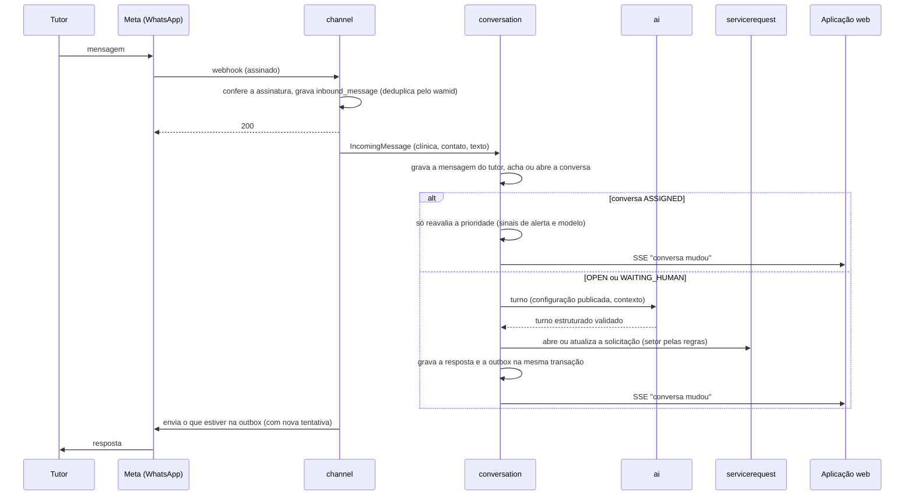
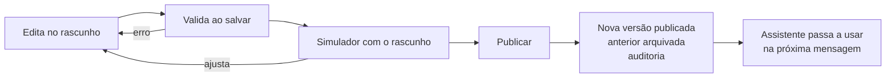

# Fluxos operacionais

> Versão 1 — 2026-11-18. Base: [PRD](prd.md), [modelo de dados](../../architecture/saas-modelo-de-dados.md), [diretrizes de atendimento](../diretrizes-de-atendimento.md) e [hierarquia de prioridades](../hierarquia-de-prioridades.md).
> "Assistente" = IA. "Equipe" = funcionário logado na aplicação web. Os textos ao tutor são exemplos; os definitivos dependem da clínica (P-10, P-01, P-02).

## 1. Nova mensagem (WhatsApp)

**Regras:**

- Mensagem repetida (mesmo `wamid`) para no primeiro passo.
- Mídia sem texto recebe um texto aprovado pedindo para escrever, e a equipe vê que chegou mídia (RF-S54).
- Fora da janela de 24 horas, só o assistente responde, porque a mensagem do tutor reabre a janela.

## 2. Identificação do tutor e do pet

1. O contato vem do canal, nunca do texto (DM-10). Se já existe um tutor da **mesma clínica** com esse contato, a conversa é ligada a ele.
2. Se não existe, o tutor só é criado quando aparece um dado aceito (DA-36).
3. O pet é reconhecido pelo nome e pela espécie (DA-35). O que não estiver confirmado fica MENCIONADO (ADR-0010).
4. A equipe vê a proveniência ao lado de cada campo e pode corrigir. A correção marca CADASTRADA.

## 3. Classificação e resposta automática

São os mesmos passos de hoje (ADR-0017): intenção, prioridade (sinais de alerta, piso e modelo), sinais, validação da resposta (ADR-0008) e próximo passo (DA-40, DA-41).

**O que muda no SaaS:**

- A configuração vem da versão publicada da clínica.
- O **nível de ativação** (DA-48) limita o que sai:
  - **nível 1:** o assistente não responde ao tutor; só classifica, extrai e abre a solicitação. O tutor recebe a mensagem de recebimento aprovada pela clínica;
  - **nível 2:** responde só perguntas sobre a clínica. Pedidos e assuntos clínicos são registrados e encaminhados;
  - **nível 3:** atendimento completo.

## 4. Encaminhamento

1. A política do assistente decide entre transferir, registrar ou oferecer (DA-40).
2. **Transferir:** a conversa vai para WAITING_HUMAN no setor da regra, ou na Recepção se não houver regra, e aparece na caixa de entrada desse setor.
3. **Registrar:** a solicitação é aberta no setor, e o assistente continua na conversa.
4. Ao tutor: "Encaminhei para a Recepção. [próximo passo conforme o horário]". Nunca "avisei" ou "alguém vai te chamar" (RN-S01).
5. A aplicação destaca a conversa para quem trabalha no setor. Não há aviso fora da aplicação no MVP (DA-47).

## 5. Atendimento humano

| Passo | Ação na web | Efeito |
|---|---|---|
| 1 | Funcionário clica **Assumir** | Se ninguém assumiu antes: estado ASSIGNED, responsável gravado, evento e auditoria. Se alguém já assumiu: aviso "já assumido por …" |
| 2 | — | A próxima mensagem automática ao tutor, se houver, diz quem assumiu. A resposta do funcionário sai com o nome dele |
| 3 | Responde, anota, consulta a ficha | Mensagem com autor STAFF; nota interna nunca vai ao tutor |
| 4a | **Devolver ao assistente** | OPEN; motivo registrado |
| 4b | **Transferir** | WAITING_HUMAN no novo setor; responsável limpo; motivo obrigatório |
| 4c | **Encerrar** | CLOSED com motivo; solicitações abertas continuam (DA-07) |

**Nova mensagem em conversa assumida:** o assistente não responde, mas a prioridade é reavaliada. Uma subida para P1 ou P2 destaca a conversa em vermelho e a coloca no topo para todos do setor, não só para o responsável (RF-S28).

## 6. Solicitação de serviço

1. O assistente coleta os dados obrigatórios (P-13) e muda a solicitação de COLLECTING para PENDING no setor da regra.
2. Na aba do setor, alguém **atribui a si** e a solicitação passa a IN_PROGRESS.
3. O funcionário resolve por fora, por exemplo marcando no sistema de gestão, e **encerra com resultado** (`SCHEDULED_BY_STAFF` e outros).
4. **Banho e tosa:** mesmo fluxo, na aba do setor que a clínica escolheu.
5. Se o tutor voltar a perguntar antes de alguém encerrar, o assistente diz que o pedido está com a equipe, sem afirmar confirmação (P-15).

## 7. Transferência entre setores

1. Na solicitação ou na conversa: **Transferir** → escolher o setor (e, opcionalmente, a pessoa) → motivo.
2. O evento TRANSFERRED registra quem, de onde, para onde e por quê.
3. Quem tem escopo "meus setores" deixa de ver a solicitação, a menos que a tenha assumido antes. O histórico fica visível para quem tem `request:view` no setor novo.

## 8. Resolução

- Solicitação encerrada com resultado.
- Conversa encerrada pela equipe ou por expiração (P-05).
- Uma conversa nova do mesmo tutor mostra até 3 solicitações abertas dele (DA-37).
- Indicadores medidos (RF-S71):
  - tempo até atribuição;
  - tempo até resolução;
  - resultado.

## 9. Reclamação

1. Intenção COMPLAINT → transferir (DA-40), na Recepção ou no setor configurado para reclamações.
2. O assistente acolhe e não se justifica nem discute (diretrizes). Ao tutor: "Registrei sua reclamação e encaminhei para a Recepção" + próximo passo.
3. A equipe trata e encerra com resultado. O retorno ao tutor depende do processo da clínica (P-14); sem processo, nada é prometido.

## 10. Possível emergência

1. Sinal de alerta aprovado (DA-27) ou indício do modelo → P1. Vale em **qualquer** estado, inclusive ASSIGNED.
2. Se o assistente responde (OPEN ou WAITING_HUMAN):
   - **clínica aberta:** orientação aprovada e "venha agora ou ligue para …";
   - **clínica fechada:** orientação de emergência fora do horário (P-01).
3. Nunca promete retorno.
4. A conversa vai ao topo de todos os setores clínicos e da Recepção, destacada.
5. Se a conversa está assumida, o assistente **não** responde. O destaque vai para o responsável e para o setor.

> **Pendência:** se o assistente deve enviar mesmo assim a orientação de emergência quando o responsável não reage em N minutos. Vai para a clínica como complemento da P-01.

## 11. Solicitação de eutanásia e luto

1. O assunto sensível é detectado pelo modelo (SENSITIVE_TOPIC, CT-19) → registrar e oferecer (DA-40), no setor Clínica.
2. O assistente:
   - usa tom acolhedor;
   - não faz oferta comercial;
   - não conduz a decisão;
   - não dá informação clínica;
   - oferece atendimento de uma pessoa sem insistir;
   - preserva o pedido original do tutor.
3. Se houver sinais de sofrimento agudo do animal, a prioridade sobe pelas regras de emergência (seção 10).
4. A Clínica vê a solicitação com prioridade e motivo, e quem assume conduz.

## 12. Configuração e publicação

## 13. Cadastro de funcionário

1. O administrador informa nome, e-mail, perfil, setores, cargo e registro (opcional).
2. A conta é criada como INVITED e o convite segue por e-mail, com link de uso único e validade.
3. A pessoa define a senha e a conta passa a ACTIVE.
4. **Desativar:** a conta passa a DISABLED, as sessões caem, as atribuições abertas voltam para o setor (RN-S07) e a auditoria registra.
